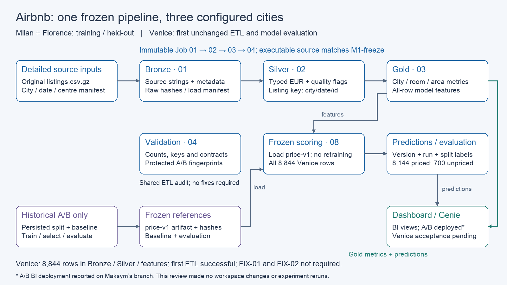

# Airbnb Northern Italy: frozen cross-city price transfer

Databricks lakehouse project by **Kalmuk Yaropolk**, **Mykolaichuk Nazar** and
**Matseliukh Maksym**. Detailed Inside Airbnb listings from Milan and Florence
support EDA, a training-only median baseline and a price model. Venice tests the
unchanged pipeline and frozen model on an unseen city. Prices are **EUR**, despite
the source's `$` formatting.

## Verified results and current status

| City / role | Snapshot | Listings | Evaluation rows | Baseline MAE EUR | Model MAE EUR |
|---|---|---:|---:|---:|---:|
| Milan / A, training + held-out | 2026-09-19 | 25,338 | 4,399 held-out | 94.38 | 75.72 |
| Florence / B, training + held-out | 2026-09-19 | 13,571 | 2,464 held-out | 97.41 | 76.18 |
| A/B combined held-out | 2026-09-19 | 38,909 | 6,863 | 95.47 | 75.88 |
| Venice / C, unseen | 2026-09-16 | 8,844 | 8,144 priced | 142.46 | 106.07 |

Venice ETL and scoring both succeeded on their first attempt. All 8,844 rows were
preserved and predicted; 700 missing-target rows have no evaluation error. Model
MAE improves on the Venice baseline by **25.5%**, while exceeding A/B model MAE by
39.8%. **FIX-01: none required. FIX-02: none required.** No pipeline correction,
retraining or model adaptation was needed. This is a transfer result, not evidence
that the model generalises equally well across cities.

The [joint transfer report](docs/week2/transfer_report.md) links sealed ETL/model
evidence and Nazar's read-only audit. This documentation review checked 59 evidence
hashes and 100 local tests; it did not rerun Venice or perform a new live audit.
PR #4 and the documentation from PR #5 are integrated into `main` with user approval.
Maksym's A/B dashboard and Genie deployment are reported in his working branch;
Venice acceptance, final presentation and submission remain pending.

## Architecture and frozen lineage

See [architecture and grains](docs/architecture.md) and the
[slide-ready SVG](docs/architecture.svg).
The immutable ETL Job runs Bronze → Silver → Gold → validation for one configured
city/snapshot. An external runtime manifest supplied Venice inputs without changing
the frozen code. Model scoring is separate from ETL and loads the preserved model.

| Reference | Value |
|---|---|
| Freeze | `M1-freeze` → `7f76cbe6936e76fa3a7685ac90b40c1ce1c253df` |
| ETL Job / immutable executable source | `816607442908043` / `f408ac01ffdd025fab6df220c8f89b24d3d4fda6` |
| Frozen model / scorer / baseline | `price-v1` / `score-v1` / `airbnb-v1` |
| First Venice ETL / scoring Job runs | `782550938914199` / `65362888524059` |
| Venice scoring run ID | `venice-2026-09-16-price-v1-score-v1-first-run` |

Executable files at the Job source match M1. The tag and original evidence remain
unchanged. Artifact SHA-256 and historical Delta versions are recorded in
[Week 1 freeze](docs/week1_freeze.md) and
[model first-run evidence](docs/week2/venice_model_first_run_2026-09-16/REPORT.md).

## Repository and reproducibility

- `airbnb/`: reusable ingestion, preparation, metrics and model modules.
- `notebooks/`: Databricks setup, EDA, ETL, validation, model training and scoring entry points.
- `config/`, `runtime/`, `jobs/`: A/B source configuration, separate Venice runtime input and immutable Job definition.
- `tests/`: synthetic local suite; no production model retraining or real-city runs.
- `docs/`: contracts, architecture, run logs, freeze/evidence and handoffs.
- `docs/presentation_script.md`: 7-minute presentation script, speaker by speaker (slides: PDF to be added under `docs/`).
- `sql/bi_views.sql`, `dashboard/`, `genie/`: BI semantic layer (`workspace.airbnb_bi`), AI/BI dashboard and Genie Agent built from code; see [dashboard and Genie](docs/dashboard_genie.md).

Start with [reproducibility instructions](docs/reproducibility.md) to verify saved
results without re-executing the experiment. For historical setup and contracts,
see [Databricks setup](docs/databricks_setup.md), [Silver](docs/silver_contract.md),
[Gold](docs/gold_contract.md), [model selection](docs/model_selection.md) and
[pipeline run log](docs/pipeline_run_log.md). Original detailed datasets/artifacts
live in Databricks volumes, not Git. Do not overwrite them to reproduce a report.

## Contributions and final handoff

| Owner | Delivered | Remaining ownership |
|---|---|---|
| Yaropolk | Configuration-driven ETL, architecture, immutable Job, freeze verification, preserved Venice first run, engineering transfer report and integration documentation | Approved repository integration; support final BI reconciliation and own engineering slides |
| Nazar | Leakage review, persisted split/baseline, frozen model/artifact, A/B evaluation, first Venice scoring and transfer diagnostics | Approved PR #4 integration; support BI reference answers and own model slides |
| Maksym | A/B EDA and cleaning handoff; BI views, three-page dashboard and Genie Agent covering Milan, Florence and Venice, reconciled with Nazar's Q1–Q6 ([dashboard and Genie](docs/dashboard_genie.md)) | Reviewed BI merge, viewer access, presentation assembly and demo |

[Task board](plan.md) records completed, review-pending and outstanding work.
[Integration review](docs/week2/integration_review.md) records the original review and subsequent main integration. PR #2 is redundant
and PR #1 should be superseded rather than merged; their closure still requires approval.

Maksym: use the [engineering handoff](docs/week2/handoff_dashboard_genie_engineering.md),
Nazar's [model/SQL handoff](docs/week2/handoff_dashboard_genie_model.md) and
[model slides outline](docs/week2/handoff_model_slides.md). Final deliverables still
need a presentation PDF/link, Venice BI screenshots/reference-answer checks,
access verification and team-admin submission. Assignment requirements are in
[the brief](group_assignment_2.pdf).
