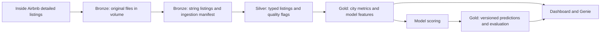

# Lakehouse architecture

Implemented: setup, parameterised bronze ingestion, EDA-informed silver preparation, gold metrics/model inputs, and a serverless Job chaining ingestion, silver, gold and validation. Feature 4 has three reported successful runs and verified silver totals/unique keys. Feature 5 adds runtime city manifests so frozen code can process a new configured city; its A/B workspace acceptance remains pending. Model predictions belong to Nazar. See [engineering handoff](engineering_handoff.md) before the joint freeze.

Bronze preserves original compressed files and source strings. Metadata identifies city, snapshot and source; repeat loads replace only one city/snapshot. The manifest records successful load counts. Silver will enforce the agreed listing key `(city, snapshot_date, listing_id)`, typed EUR nightly price and explicit exclusion reasons. Gold will provide shared definitions for dashboard/Genie metrics, leakage-reviewed features and versioned model outputs.

Milan and Florence are the only Week 1 inputs. Before Week 2, freeze the pipeline and model revision. Venice must then run with that frozen implementation before any pipeline fixes or model changes are made; preserve the first-run evidence.
