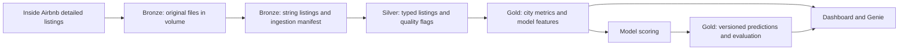

# Lakehouse architecture

Implemented in this branch: setup of the three namespaces and original-file volume, plus one parameterised training-city bronze ingestion notebook. Silver, gold and job orchestration are subsequent features.

Bronze preserves original compressed files and source strings. Metadata identifies city, snapshot and source; repeat loads replace only one city/snapshot. The manifest records successful load counts. Silver will enforce the agreed listing key `(city, snapshot_date, listing_id)`, typed EUR nightly price and explicit exclusion reasons. Gold will provide shared definitions for dashboard/Genie metrics, leakage-reviewed features and versioned model outputs.

Milan and Florence are the only Week 1 inputs. Before Week 2, freeze the pipeline and model revision. Venice must then run with that frozen implementation before any pipeline fixes or model changes are made; preserve the first-run evidence.
