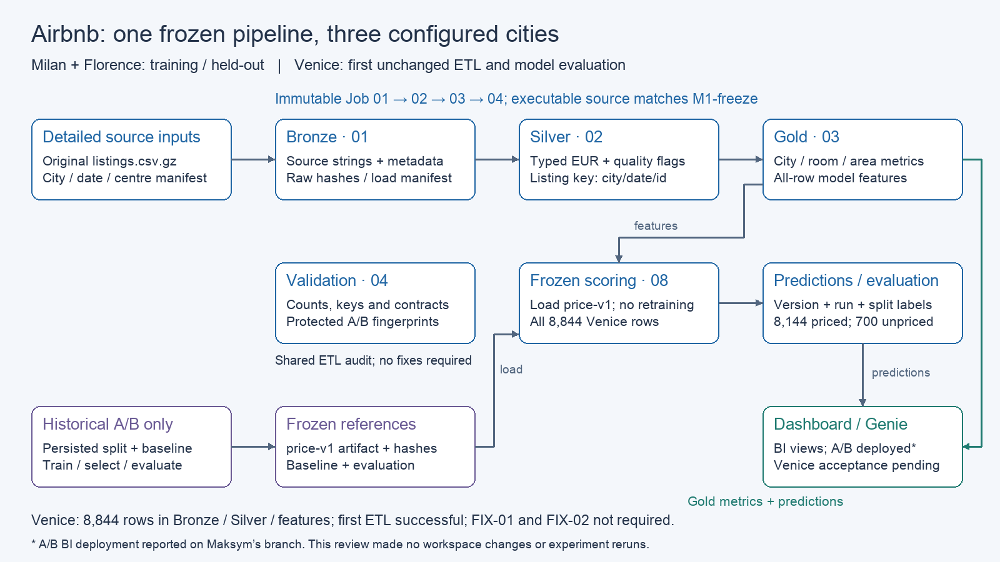
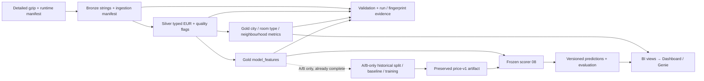

# Lakehouse architecture

[SVG for slides](architecture.svg). Implemented frozen ETL/model and preserved
Venice results are shown below. BI assets are on Maksym's branch; Venice acceptance
and approved repository integration remain pending.

## Execution and ownership

Job `816607442908043` chains notebooks **01 → 02 → 03 → 04**. Its Git source is
immutable commit `f408ac01ffdd025fab6df220c8f89b24d3d4fda6`; executable files match
`M1-freeze` (`7f76cbe6936e76fa3a7685ac90b40c1ce1c253df`). Setup (00) and Job
registration (05) are administrative entry points, not recurring ETL tasks.
Configuration supplies city, snapshot, raw path and centre; an external runtime
manifest added Venice without editing frozen modules or A/B configuration.

Yaropolk owns ETL/validation and run evidence. Nazar owns model lineage: 06 persisted
the A/B split and baseline; 07 selected/trained/evaluated the original model; 08 loads
that artifact for scoring. These historical steps are not instructions to retrain.
Venice first ETL and scoring are complete; no rerun is needed for this handoff.
Maksym's BI views read Gold without changing frozen Gold definitions.

## Data contracts and protection

| Layer | Grain / meaning |
|---|---|
| Raw volume | Original detailed compressed source; preserve file hash and source/date |
| Bronze | Source strings plus ingestion metadata; replace only requested city/snapshot |
| Silver | `(city, snapshot_date, listing_id)`; typed EUR price, textual null handling, explicit quality/exclusion flags |
| Gold metrics | City/snapshot, city/snapshot/room type, city/snapshot/neighbourhood; analytical population is explicitly filtered |
| Gold model features | One listing key, including missing targets; persisted model preprocessing applies later |
| Predictions | Listing key plus model version; scoring identity, split, prediction, actual, baseline and nullable error |
| Model references | A/B train-only baseline, split, artifact metadata, selection and evaluation records; frozen separately from scoring results |

Milan/Florence have 25,338/13,571 rows; Venice retains 8,844 through all ETL layers.
Venice analytical count is 8,101; MAE uses all 8,144 positive-price targets, including
tail classes. Seven hundred unpriced rows are predicted but not evaluated.
Dashboard training rows must never enter held-out/unseen MAE. Filter snapshots,
`model_version = 'price-v1'`, split and the first Venice `scoring_run_id`.

ETL verified 19 protected A/B/model object fingerprints unchanged; the later model
run verified its separate set of 15 table fingerprints. Source files, artifact
hash, original tag and historical evidence are preserved. FIX-01 and FIX-02 are
both **not required**. See [transfer report](week2/transfer_report.md),
[reproducibility](reproducibility.md) and [BI handoff](week2/handoff_dashboard_genie_engineering.md).
